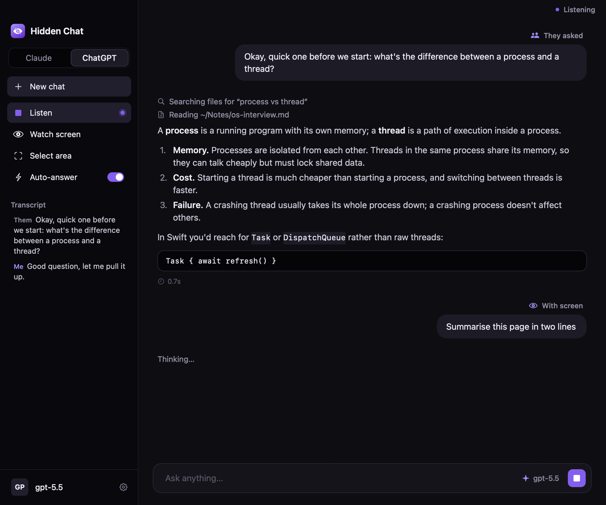

# Hidden Chat

A floating AI assistant for macOS that stays out of screen sharing, screenshots and recordings. It can listen to your calls, read your screen, and answer with Claude or ChatGPT.



## What it does

- **Chat** with Claude or ChatGPT in a window that doesn't appear when you share your screen.
- **Listen** turns your microphone ("Me") and your Mac's sound, such as the other people on a call ("Them"), into a live transcript. Speech recognition runs on your Mac.
- **Auto-answer** replies when someone asks a question or makes a request out loud, like "what's the difference between a process and a thread?" or "write me a logistic regression model from scratch".
- **Watch screen** spots questions on your screen and outlines them, with a **Solve** button.
- **Select area** watches part of the screen and answers questions that appear there.
- **Your files (Claude only):** Claude can find and read files on your Mac, and asks before writing a file or running a command.

## Requirements

- macOS 26 or newer, on a Mac with Apple silicon
- An API key from [Anthropic](https://console.anthropic.com) or [OpenAI](https://platform.openai.com/api-keys). API use is billed by them, separately from a Claude or ChatGPT subscription.

## Install

### Download

1. Download `HiddenChat.zip` from the [latest release](../../releases/latest).
2. Unzip it and move **Hidden Chat** to your Applications folder.
3. Open it. macOS will say it can't verify the app, because it isn't signed with an Apple developer certificate yet. Click **Done**, then go to **System Settings › Privacy & Security**, scroll down, and click **Open Anyway**.

### Build it yourself

You need Apple's command line developer tools (`xcode-select --install`).

```bash
git clone https://github.com/adebayopelumi/hidden-chat.git
cd hidden-chat
./build.sh
open HiddenChat.app
```

An app you build yourself opens without the warning.

## First run

1. Open **Settings** (⌘,), choose Claude or ChatGPT, paste your API key and click **Save**.
2. Allow the permissions when asked:
   - **Microphone**, for Listen.
   - **Screen & System Audio Recording**, for call audio, Watch screen and Select area. Turn on Hidden Chat in **System Settings › Privacy & Security › Screen & System Audio Recording**, then quit and reopen the app.

## Shortcuts

| Shortcut | Action |
|---|---|
| ⌘N | New chat |
| ⌘. | Stop the reply |
| ⌘L | Listen / stop listening |
| ⇧⌘S | Watch screen / stop watching |
| ⇧⌘A | Select an area / stop |
| ⌃⌘S | Show / hide the sidebar |
| ⌘, | Settings |

## Tips

- **Wear headphones on calls**, so the microphone doesn't hear the other side a second time.
- **Speech language:** if Listen mishears you, try another English variant in **Settings › Speech recognition language**. Automatic picks the closest one for your region.
- **After rebuilding the app**, macOS forgets the Screen & System Audio Recording permission. Remove Hidden Chat from that list with **−**, add it again with **+**, then reopen it.

## Privacy

- Speech is turned into text on your Mac. Audio is never uploaded.
- When it answers, Hidden Chat sends your question, the recent transcript, and text or images from your screen (when you use Watch screen or Select area) to the provider you chose, Anthropic or OpenAI. Apart from macOS downloading its speech model once, it talks to no other servers.
- API keys are saved only on your Mac, in `~/Library/Application Support/HiddenWindow/config.json`, readable only by your user account.
